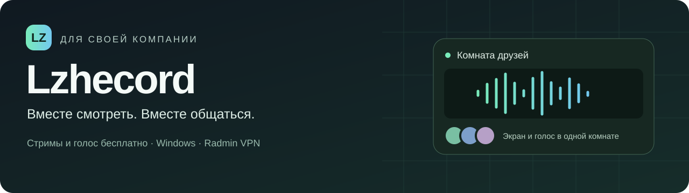

<h1 align="center">Lzhecord</h1>

<strong>Смотрите фильмы, показывайте экран и разговаривайте с друзьями бесплатно — без Discord Nitro.</strong>

Windows 10/11 x64 · Голос и системный звук · Radmin VPN · До 5 участников

<a href="https://github.com/evanc0/Lzhecord/releases/tag/v0.9.3"><strong>Скачать приложение 0.9.3</strong></a> · <a href="docs/USAGE.md">Как пользоваться</a> · <a href="docs/FAQ.md">Частые вопросы</a>

## Для чего это

Discord недоступен, а хочется собраться своей компанией? Или посмотреть фильм вместе и передавать картинку в хорошем качестве без покупки Nitro? Lzhecord объединяет трансляцию и голосовую комнату в одном приложении.

Подключитесь с друзьями к одной сети Radmin VPN, войдите в комнату и включите показ экрана. Голосовое общение уже встроено: можно обсуждать фильм во время просмотра или просто разговаривать без трансляции.

**Пользоваться приложением можно бесплатно.** Разрешение, FPS и битрейт не закрыты подпиской. Фактическое качество и плавность зависят от ваших компьютеров, нагрузки, сети и числа зрителей. Платный сервер не нужен; работающий Radmin VPN нужен каждому участнику.

## Что умеет

| Возможность | Как это работает |
| --- | --- |
| Авто · аппаратный захват | Определение видеокарты/драйвера, загрузка совместимого пакета; NVIDIA NVENC, AMD AMF и Intel Quick Sync; обычный захват при недоступности GPU |
| Фильм или экран со звуком | Выбор монитора или окна по карточкам, передача системного звука |
| Голос прямо в комнате | Выбор микрофона, мут, выключение звука комнаты, шумоподавление, порог активации и личная громкость собеседника 0–200% |
| Настройки качества без подписки | Раздельные разрешение, FPS и битрейт; исходный размер, ultrawide 3440×1440 и свои размеры |
| Изменение во время стрима | Качество и FPS можно менять без выхода из комнаты |
| Защита от возврата голоса | Основной захват может исключать звук Lzhecord из передаваемого системного микса |
| Комнаты для друзей | Автоматический поиск через Radmin VPN и подключение по Radmin IP |
| Свой профиль и оформление | Имя, аватарка и 18 тем, включая анимированные |

## Скачать

| Вариант | Загрузка | Запуск |
| --- | --- | --- |
| **Приложение 0.9.3 — рекомендуем для первого теста** | [Lzhecord-Desktop-0.9.3-win-x64.zip](https://github.com/evanc0/Lzhecord/releases/download/v0.9.3/Lzhecord-Desktop-0.9.3-win-x64.zip) | Распаковать целиком → `Lzhecord.exe`. Внешний браузер не нужен |
| Браузерный вариант 0.6.3 | [Lzhecord-Radmin-0.6.3.zip](https://github.com/evanc0/Lzhecord/releases/download/v0.6.3/Lzhecord-Radmin-0.6.3.zip) | Распаковать целиком → `START.cmd`. Нужен Edge или Chrome |

Это **тестовые сборки для Windows 10/11 x64**. Для GPU-режима ведущему при первом запуске потребуется загрузка около 110 МБ компонентов. Для обычного захвата она не нужна. Все файлы из архива обязательны: один exe отдельно работать не будет. Встроенные компоненты устанавливать отдельно не нужно. Контрольные суммы доступны в каждом релизе.

Кнопка GitHub **Code → Download ZIP** и автоматические архивы **Source code** загружают материалы этой страницы, а не готовую программу. Для запуска используйте ссылки выше.

## Первый запуск за несколько шагов

1. Установите [Radmin VPN](https://www.radmin-vpn.com/) и подключитесь с друзьями к одной сети.
2. Скачайте и распакуйте Lzhecord у каждого участника. **Используйте 0.9.3; для TCP-восстановления обновите обоих участников и создателя комнаты; базовый протокол совместим с 0.8.x–0.9.1.** Версии 0.7.0 и 0.6.3 несовместимы с комнатами 0.8.x.
3. Запустите `Lzhecord.exe`. Если Windows запрашивает доступ к сети, разрешите его для используемой сети. Другую версию Lzhecord перед этим закройте.
4. Один человек создаёт комнату. Остальные выбирают её в списке или подключаются по Radmin IP создателя.
5. Включите микрофон отдельной кнопкой. Для фильма нажмите «Показать экран», выберите источник и включите передачу системного звука.

Выберите **«Авто — аппаратный захват монитора»** при показе экрана, затем монитор и системный звук. Программа определит видеокарту и драйвер и загрузит совместимый пакет у ведущего. Для NVIDIA 570–609 используется совместимый FFmpeg 8.1, от 610 — текущий FFmpeg 9. AMD AMF и Intel Quick Sync пока требуют проверки на соответствующих ПК. Зрителям загрузка не нужна. В 0.9.3 сетевой обмен GPU-видео выполняет сам **Lzhecord** через Radmin, **UDP 8790**. MediaMTX работает только локально. Если Windows спросит о сети для Lzhecord, разрешите доступ через вашу сеть Radmin. Если кадры не появляются или перестают обновляться, просмотр автоматически переключается на надёжный TCP-канал через уже используемый порт 8789. Если подключение к ведущему не проходит, приложение пробует обратное подключение от ведущего к зрителю. Внешний сервер не нужен. Обычный и резервный захваты остаются доступны.

GPU-режим пока тестовый: до 60 FPS, только монитор. Смена качества кратко переподключает видео, сохраняя комнату и голос. Автоматическая подстройка битрейта под каждого зрителя пока не реализована; при плохой сети уменьшайте его вручную. [GPU-режим 0.8.0](docs/releases/v0.8.0.md) · [Исправление звука 0.8.1](docs/releases/v0.8.1.md) · [Громкость до 200%](docs/releases/v0.8.2.md) · [Автовыбор и диагностика](docs/releases/v0.9.0.md) · [Ограничение FPS и обратный TCP — 0.9.3](docs/releases/v0.9.3.md).

[Полная инструкция: микрофон, качество, совместный просмотр и обновление →](docs/USAGE.md)

## Что важно знать

- До **пяти человек** в комнате: создатель и четыре гостя. Одновременно идёт одна трансляция.
- Комнаты предназначены для **доверенной VPN-сети друзей**. Дополнительного пароля Lzhecord нет; не приглашайте незнакомых людей в вашу VPN-сеть.
- Основной захват окна передаёт **системный звук**, а не только звук выбранного окна. Для исключения голосов оставьте защиту звука комнаты включённой.
- У резервного захвата возможны рамка и возврат голосов в трансляцию. Некоторые защищённые окна не отдают изображение.
- Недоступность Discord не делает Lzhecord зависимым от него. При этом доступность самого Radmin VPN и связи между вашими ПК необходима.
- Пока сборки не подписаны сертификатом издателя. Не отключайте защиту Windows целиком; проверяйте источник и контрольные суммы.

## Помощь и обратная связь

[Частые вопросы](docs/FAQ.md): не видна комната, запрещён микрофон, серый кадр, слышно себя, занятый порт и ошибка Program Files.

Нашли проблему? [Сообщите об ошибке](https://github.com/evanc0/Lzhecord/issues/new/choose): укажите версию, Windows, способ захвата и шаги. Диагностику можно сохранить из приложения; перед отправкой просмотрите её. Не публикуйте пароли VPN, папку `data`, профиль браузера и личные данные на скриншотах.

## Бесплатное использование

Официальные готовые сборки разрешено бесплатно скачивать, устанавливать и использовать. **Это не объявление исходников под MIT или другой свободной лицензией**: их лицензирование будет решено отдельно. Репозиторий служит страницей приложения, местом для документации и сообщений об ошибках.

[Условия использования](USAGE_TERMS.md) · [Сторонние компоненты и лицензии](THIRD_PARTY_NOTICES.md)

Lzhecord — самостоятельный проект, не связанный с Discord Inc. Discord и Nitro упоминаются для объяснения назначения приложения.

## Поддержать автора

Если Lzhecord оказался полезен, можно поддержать его развитие. Поддержка добровольная — приложение остаётся бесплатным.

**[Поддержать через DonationAlerts](https://www.donationalerts.com/r/evanc0)**

| Валюта и сеть | Адрес |
| --- | --- |
| USDT · TRON (TRC20) | `THpbMdkwDK9ZH37z4HBcNR94gUBjcHTo5z` |
| USDT · Ethereum (ERC20) | `0x3409CE6eA17D966b34c6C979A8E164D5f7a1b660` |
